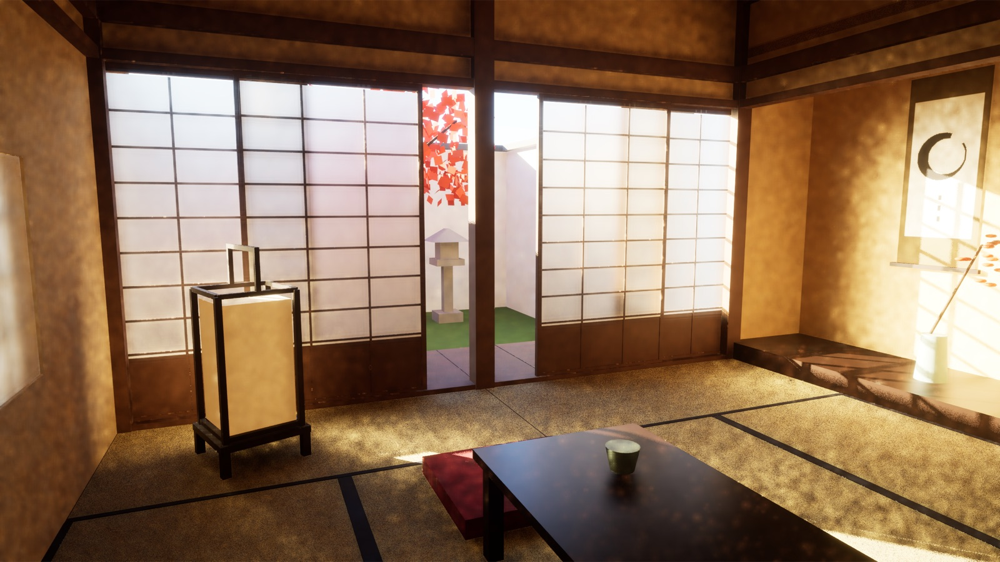

# The back parlour of a machiya in Gion

A sample place for [EarthRT](https://github.com/threert/EarthRT): the eight-tatami back room of a Kyoto townhouse
off Hanamikoji, with shoji onto a walled moss garden and its maple, a tokonoma with an ensō scroll and a vase, staggered
shelves, fusuma, and an andon that lights the room in the evening. Made from
[threert/earth-place-template](https://github.com/threert/earth-place-template).

| day | evening |
| --- | --- |
|  |  |

*Path-traced by ThreeRT.*

- The room is a ThreeRT scene module ([scene/main.ts](scene/main.ts)): the EarthRT app's traced view draws it when
  you go in (within 40 m: `enterFrom`); the map, on the web and in the app, shows its baked GLB
  (`assets/models/scene.glb`) from the air.
- The andon is a GLB of its own ([scene/andon.ts](scene/andon.ts), baked by `bun tools/models.ts`), drawn by both.
- Kind `interior`, topic `interior:gion-machiya`. Everything is made in code: CC0.

Make your own version of it: open it in the EarthRT app and **Remix**
and read [AGENTS.md](AGENTS.md).
